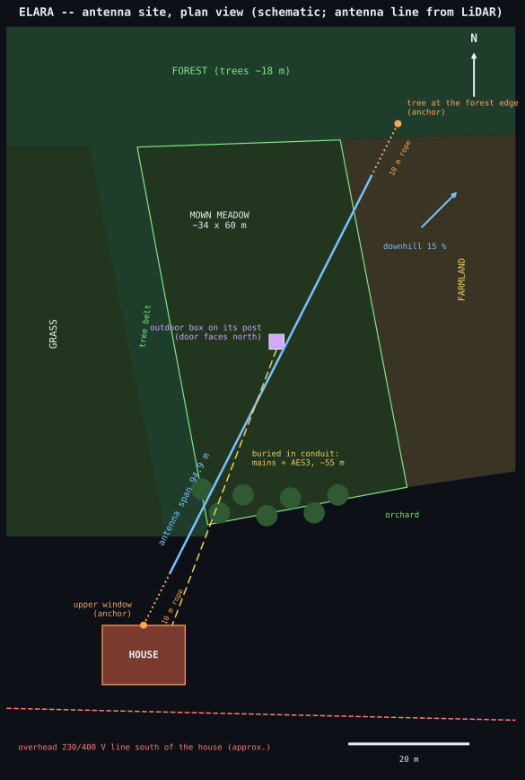
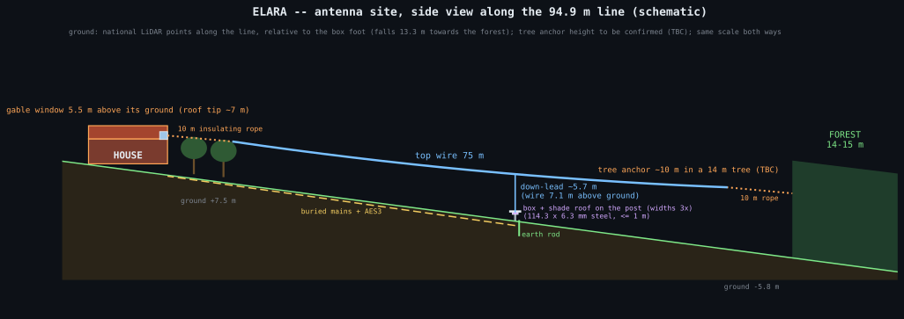

# ELARA -- mechanical assembly and site mounting (rev 0.2)

This guide takes you from machined parts to a working outdoor unit on site. It
covers the shield, the PSU box, the plate capacitors, the outdoor box, the
antenna and earthing, and commissioning. Soldering and bring-up of the boards
are in [ASSEMBLY.md](ASSEMBLY.md). Part numbers and drawings are in
[mechanical/README.md](mechanical/README.md), and local suppliers in
[mechanical/SUPPLIERS_SI.md](mechanical/SUPPLIERS_SI.md). The mains feed is in
[MAINS_CABLE.md](MAINS_CABLE.md).

```text
                         antenna (T: ~10 m vertical, ~15 m top wire)
                               |
   +---------------------------|----------- outdoor box (Fibox ARCA 403015) ---+
   |   [ plate capacitors C_A, C_B on the POM base ]   <- M12 gland (top)      |
   |   [ amplifier shield: 3 compartments, lid on the mounting plate ]         |
   |   [ PSU box: two-bucket supply ]                                          |
   +----- M20 mains gland --------------------------------- M16 AES3 gland ----+
            |                                                  |
   shielded mains cable (MAINS_CABLE.md)          AES3 on shielded Cat5e/6 to the PC
```

## 1. Tools and consumables

- Hex keys 2 and 2.5 mm, and a torque screwdriver (0.5-1.5 N·m).
- An M3 tap and holder, in case a thread needs chasing.
- A flat reference surface (glass or a surface plate) and P240 / P400 wet
  abrasive paper, for lapping the shield frame.
- A multimeter with a milliohm range, or a 4-wire method, and an LCR meter
  (100 kHz range, pF resolution) for the plate capacitors.
- IPA (99 %), lint-free wipes, nitrile gloves.
- Cable ties (UV-stabilised), ferrule crimper, heat-shrink, silica-gel
  desiccant bag.
- For the site: spade, earth rod and clamp (section 6), a ladder or mast
  hardware, and insulators for the antenna wire.

## 2. Amplifier shield

Parts A1-A9 are listed in `mechanical/README.md` section 1. The frame is 7 mm
aluminium bars sitting on the exposed 7 mm GND strips of the board.

1. **Check the parts.** Every contact face must be bare metal: **no anodising
   or paint**. Deburr all holes. The right-hand end bar (A2) carries the RJ45
   (AES3) notch and the top long bar (A1) the Micro-Fit notch. Both are notches
   down to the PCB face, not holes.
2. **Build the frame.** Join the six bars with the 16 M3x16 socket caps on
   the flat surface, snug but not tight. Press the frame down so all bottoms
   lie on the surface, then tighten crosswise to **1.0 N·m**.
3. **Check and lap the bottom face.** This face is the RF seal against the GND
   strip. With the frame bottom-down on glass, a 0.05 mm feeler must not enter
   anywhere. If it does, lap on P240 then P400 abrasive paper on the glass with
   figure-of-eight strokes until it doesn't. Clean with IPA.
4. **Fit both PTFE feed-through bushes** into the tray's two Ø10 holes from the
   outside, flange out: one under J201 (x 20 / y 50.1) for the node-2 lead, one
   under J203 (x 20 / y 72) for the plate-return wire. Touch them only with gloves.
5. **Stack it, upside down:** frame (lid side down) on the bench, then the
   assembled and cleaned PCB (component side down, so the walls land on the
   strips), then the tray (A5) on top.
   - The Micro-Fit and the RJ45 must sit at their notches.
   - Look into the RJ45 notch: the jack's metal shell must not touch the bar
     (it is the AES3 cable shield, isolated from GND); there is 1.2 mm of air
     between its face and the wall.
   - The tray has a small relief pocket in its rim for the Micro-Fit's PCB-lock
     peg: make sure the board sits flat on the tray all round.
6. **Screw it together.** Fit the 24 M3x25 button heads through the tray and
   tighten crosswise in two passes to **0.8 N·m**. Do not use threadlocker; it
   would insulate the thread contact.
7. **Continuity check.** Measure from each wall bar to the GND test point
   (TP204). Expect well under 0.1 Ohm. Also measure from the tray to the frame,
   which should read about the same.
8. **Fit the lid** (A4) with the 24 M3x8 button heads, crosswise, to
   **0.6 N·m**. The lid's four ears are the mounting face (section 5).

Service access is from the tray side. Undo the 24 tray screws and the board
lifts out while the lid and frame stay on the mounting plate.

## 3. PSU box

Parts P1-P6 are in `mechanical/README.md` section 2. The box has 50 x 6 mm
bar walls on a 3 mm base.

1. Screw the four bars together (M3 into the short-bar ends), then onto the
   base with the M3x8 screws.
2. **PE stud first.** Fit the M4 x 20 button head from outside through the
   Ø4.5 hole in the mains-end bar (above the IRM-05, 40 mm up), with a serrated
   washer under the head and, inside, a serrated washer and nut. The mains PE
   ring terminal, a washer, a nut and the lock nut go on later. Scrape any
   coating off under the washers. **PE continuity from the stud to every bar
   and to the base must read under 0.1 Ohm.**
3. Screw the standoffs onto the base: **metal M3x10 at the mains end** (H1/H3,
   the board's plated PE holes) and **nylon M3x10 with nylon screws at the
   receiver end** (H2/H4). Never metal at H2/H4: the receiver side must not
   touch PE. Fit the PSU board, mains end (J1) to the M16 gland.
   The LM317s (U1, U2) are screwed flat onto their copper areas on the board and
   are **not** bolted to the aluminium base (0.17-0.22 W each in normal use; in a
   crowbar fault the CC LM317 protects itself with its thermal limit). Both tabs
   are live (CC_SET and CHG) and the base is PE / GND_C: check with a meter that
   neither tab connects to the base. See ASSEMBLY.md section 6, step 0.
4. **Check the cells before fitting** C8-C15, the 10 x 31.5 mm EDLCs. Measure
   and match them (within 5 %), and observe polarity. They stand upright with
   about 6.5 mm to spare under the lid.
5. **Fit the glands:** M16 at the mains end (low, in line with J1), M12 at the
   DC-output end (high, in line with J2), with their locknuts inside.
6. **Wire it.** The mains lead from the heater rail terminals (step 8) goes to J1
   (L, N) across the free bay in front of it, and its PE conductor to the stud, with a short link from the stud to
   J1 pin 3; see MAINS_CABLE.md. The DC cable's Micro-Fit plug goes into J2
   across the free channel in front of it, and the cable out through the M12
   gland to the amplifier.
7. **Fit the lid** after the 15 V bench steps of ASSEMBLY.md section 6 (the only
   steps done with the lid off). Every test on mains is done with the lid on, in
   the closed, earthed box.
8. **Box heater rail (mains operation only).** Screw the 160 mm long 35 mm DIN
   rail (HT3) horizontally onto the outside of the PSU box lid with 2 x M4x8. Clip
   on the STEGO HG 140 30 W heater (HT1) at one end, fins vertical, connection at
   the bottom; the terminal group in the middle between two E/UK end clamps (UT 2.5
   for L and N, UT 2.5-PE, the UT 4-HESI fuse terminal with the ceramic T 4 A fuse,
   the D-UT 2.5/10 end cover on the open side); and the KTO 111 thermostat (HT2)
   at the far end from the heater, never above it, or it reads the heater's own
   warm air. Set it to **+5 C** (it opens on rising temperature; 7 K switching
   differential). The tallest part reaches 117.5 mm in the 144 mm deep outdoor box
   (`params.check()` keeps at least 5 mm to the door). The heater runs on mains
   only, never from the receiver supply; a battery-only installation has no
   heater. Wiring: MAINS_CABLE.md section 4.

## 4. Plate capacitors

The capacitor section is described in `mechanical/README.md` section 3. Each
capacitor is two 64 x 64 plates, copper facing copper, 0.5 mm apart.

1. **Pair and clean the plates.** Measure the thickness of all plates and pair
   the two plates of each capacitor within 0.02 mm. Wash the plates, the alumina
   washers and discs in IPA and let them dry. From here on, handle them only by
   the edges and with gloves. Epoxy-bond one alumina disc (Ø6 / 3.2 x 0.5) to the
   centre of each lower plate's copper and let it cure.
2. **Build each capacitor** on its 4 PTFE standoffs on the POM base.
   - Lower plate first, copper up: this is the plate return (RET, 2.5 V), not
     GND.
   - Then the four 96 % alumina washers (Ø6 / 3.2 x 0.5) on the copper landing
     rings.
   - Then the upper plate, copper down, turned over left-right: its two solder
     tongues must sit where the lower plate has none (the four tongues of a
     pair alternate, two on each side).
   - Then the 4 PEEK M3x25 cheese-head screws, each with a stainless M3 wave
     spring under the head. Tighten until each spring is compressed to about
     30 N (nearly flat), evenly; the springs hold the clamp at 29-31 N from -20
     to +60 °C (`mechanical/README.md` section 3).
3. **Measure each capacitor** with the LCR meter at 100 kHz, leads as short as
   possible. Expect **49-52 pF**. A reading well above that is a sign of bowing
   or a trapped particle: open the stack and check it.
4. **Wire the section.** Solder only on the tongues.
   - R1 (33k): ANT post to the node1 (C_A upper) tongue on the ANT side.
   - R2 (33k): node1's other tongue to the node2 (C_B upper) tongue across the
     gap, in air.
   - Then the short wires from the gap-side tongue of each lower plate down to
     the RET post (the plate return; it is engraved RET and is NOT ground).
   - Then the node-2 lead from the IN+ turret.
   - Nothing may touch the POM between node pads. Clean with IPA after
     soldering.

## 5. Outdoor box

1. **Mounting plate.** Press the M4 studs into the 8 mm PE-HD plate from the
   back, per `dxf/mounting_plate.dxf`. Bond the two PA66 mid supports (B13,
   Ø14 x 10, female M4) to the box back at (±110, +50) mm with MS-polymer (B13a)
   and let it cure. Then fix the plate into the box with 4 x M4 screws into the
   floor bosses and countersunk M4 screws into the two mid supports (they lift the
   plate's first mode from 27.7 Hz to 115 Hz).
2. **Glands.** M12 (antenna) at the top, M20 (mains) and M16 (AES3) at the
   bottom, from `mechanical/README.md` section 4. Fit them with their seals,
   locknuts inside, and tighten to the gland maker's torque.
3. **Drop the units onto their studs**, top to bottom:
   - capacitor base, directly on the plate
   - amplifier shield, lid down, on 5 mm spacers
   - PSU box, on 5 mm spacers

   Fit the M4 nyloc or knurled nuts.
4. **Wire the box** in this order:
   1. The plate-return wire from the RET post through the second PTFE bush
      (under J203) to J203. It does not touch the tray: RET sits at 2.5 V.
   2. The node-2 lead from the IN+ turret through the first PTFE bush to J201,
      beside the plate-return wire: **solid 0.8 mm silver-plated copper** in PTFE
      sleeving, short and straight, held halfway on a PTFE post (a 10 mm PTFE rod
      piece with a 1.2 mm hole, bonded to the mounting plate) so its first mode is
      above 150 Hz. Tie the antenna lead to a second PTFE post right after its
      gland. Stranded wire here resonated near 28 Hz.
      Keep it at least 10 mm from any metal and free of kinks.
   3. The DC cable from the PSU's J2 to the amplifier's J101: a shielded
      pair. Connect the shield at the amplifier end only, to a tray screw.
      Never connect it to the PSU box, which is on mains PE: that would bond
      PE to the receiver ground and defeat the two-bucket isolation.
   4. The AES3 cable: shielded Cat5e/6 (S/FTP or F/UTP) with a shielded RJ45
      plug. Pass the cable through the M16 gland first, then crimp the plug
      (or use a field-installable plug); a crimped plug does not pass a gland
      seal. AES3 uses the blue pair, pins 4 and 5; the other pairs stay unused
      (reserved for isolated control signals in a later revision). Push the
      plug into J401 through the notch. Per PLAN section 5 only the indoor end
      grounds the shield; C406 stays unfitted, so the outdoor end of the
      shield floats and the link stays galvanically isolated.
   5. **Indoor end:** an RJ45-to-XLR adapter (pin 4 to XLR 2, pin 5 to XLR 3,
      shield to XLR 1) into an AES3 input, or a 110 Ohm to 75 Ohm balun into
      an S/PDIF coaxial input. Its shield connection there is the only one.
   6. The mains cable onto the heater rail terminals, and from there into the PSU
      box and to the heater (MAINS_CABLE.md section 4).
   7. The antenna wire, last (section 6).
5. **Dress the cables** with UV-stabilised ties. Give each cable a drip loop
   before its gland, so water runs off below the entry and not along the cable.
6. **Condensation.** Keep the box **sealed**: fit the ePTFE membrane vent (B8, M12)
   in the bottom wall, never an open breather hole, and put in fresh silica gel (B9)
   and a humidity indicator card (B10). In a box that exchanges air with the outside
   the inner walls fall 6.5 K and the amplifier board 1 K below the dew point on a
   calm, clear autumn night; sealed with silica gel it stays at least 5.5 K clear
   (`simulations/thermal`).
7. **Sun and rain shade roof (required; built 2026-10-31).** The roof is white-painted
   2 mm aluminium (B11, B12), **500 x 500 mm, centred over the box**, so it overhangs
   every side: on a free-standing post the sun reaches the back of the box too. Fold
   a 15 mm drip flange on all four edges (the 530 x 530 sheet allows for it). It
   sits **30 mm above the box top on two galvanised flat-bar arms** (B14: 30 x 4,
   bent to an L with a 500 mm arm under the roof and a 200 mm leg down the post),
   clamped to the 114.3 x 6.3 mm post with M10 U-bolts (B14a). **Never fix it to the
   box**: a 1 mm sheet on the box rang at 16 Hz.
   - **Antenna lead.** Drill a 20 mm hole right above the M12 antenna gland and fit
     the EPDM grommet (B15). The down-lead comes vertically through it; leave a drip
     loop below the roof so rain runs off the lead before it reaches the gland. The
     lead's capacitance to the roof through the hole is about 0.05 pF: negligible.
   - **Earth the roof.** Bond it to the receiver earth (the earth rod / tray
     conductor, section 6) with the 4 mm² green-yellow lead and M5 ring lugs (B16).
     A floating metal roof charges up in wind and rain right next to the antenna lead.
   - **Door N or S.** On a record 40 C day with a light grey box the roof keeps the
     EDLCs at 62.0 C (door facing S), 62.2 C (N), 62.8 C (W) or 63.7 C (E, the
     worst), all under their 65 C rating; without the roof they reach 65.4 C
     (`simulations/thermal`). Face the door north or south. The roof also reduces the
     night-sky cooling that drives condensation.
   - The roof and its arms add 3.1 kg at the post top: the post's first mode drops
     from 71 Hz to 62 Hz, still above the Schumann band. A storm lifts the roof with
     about 211 N (about 105 N per arm); snow loads it with about 300 N
     (`simulations/mechanics`).
   Never paint the box dark (a black box cooks the EDLCs well past 65 C).

## 6. Site mounting

**Where.** Choose an open site as far as practicable from mains overhead lines,
transformers, fences with electric energisers and buildings. PLAN section 3.1
sizes the 50 Hz headroom for a power line about 100 m away. Keep the antenna wire
itself well clear of walls, trees and masts (they distort the vertical E-field
and, close to the wire, add leakage and wind noise): anchor it to them only
through long insulating ropes.

**The planned site** (2026-10-31; antenna line, box and ground from the national LiDAR,
the rest from a map screenshot; the tree anchor height still to be confirmed): a mown
meadow of about 34 x 60 m with forest to the north, a belt of trees and more grass to
the west, farmland to the east and the house to the south. The antenna runs 95 m
(bearing ~27 deg) from the upper gable window of the house (5.5 m above its ground,
just above the eaves; the roof tip is about 7 m) to a tree at the forest edge. The outdoor box stands on its
stiff post 53 m from the window, 1.6 m off the line, where the vertical down-lead drops
(at ELF the antenna is a pure capacitance, so the down-lead need not be at mid-span).
The mains and AES3 cables run about 55 m to the house, buried in conduit (the meadow is
mown). An overhead 230/400 V line passes south of the house. Eleven LiDAR ground points
put the whole meadow on one inclined plane within 0.24 m: a 15 % fall towards the
north-east, no hollows or bumps; along the antenna line the ground falls 13.3 m (+7.5 m
at the house, -5.8 m at the forest end, relative to the box). Water runs north-east:
lay the buried cables and set the earth rod accordingly, and set the post plumb and the
roof level on the slope. The forest-edge trees are 14-15 m tall (LiDAR canopy points;
the anchor tree 14 m); with the anchor about 10 m up it (two thirds, where the trunk is
still sound), the wire slopes gently down towards the forest and hangs about 7.1 m
above the box's ground: a down-lead of about 5.7 m and a top wire of about 75 m between
the 10 m ropes.





**The antenna** is a Marconi T: a vertical down-lead with a top wire.
- **10 m of insulating rope at each end** (UV-stable polyester or Dyneema) between
  the wire and its anchor: the wire must not end at the house wall (its wiring is a
  strong 50 Hz source at close range) or among wet branches.
- **Start small, then lengthen.** The front end is designed for about 10 m vertical
  and 15 m of top wire (C_ant 140 pF). The full ~75 m top wire at 7-13 m height is
  roughly 450-550 pF: more signal (less capacitive-divider loss) but also more
  50 Hz, and the input clips at 29.5 mV rms of 50 Hz at the antenna, about 3 mV/m of
  field with 8-10 m effective height. Put it up first with a short top wire, measure
  the 50 Hz level on site with the battery build (section 7), and lengthen the wire
  only as far as that headroom allows.
- Use insulated wire, high enough over the meadow for the mower and clear of the
  orchard trees next to the house.
- The down-lead runs vertically through the shade roof's grommet to the M12 gland
  at the top of the box, with a drip loop below the roof, just above the gland.
- Keep the down-lead away from any mast or tree by stand-off insulators, at least
  30 cm.

**The outdoor box** mounts on a **stiff post** at the foot of the down-lead, about
1 m above ground: a 114.3 x 6.3 mm steel post at most 1 m tall (first mode 71 Hz
bare, 62 Hz with the shade roof and its arms, still above the Schumann band). A
building wall is the alternative where the down-lead ends at a wall. **Never on a
thin pole or stilt, a pipe or the antenna mast**: a 1.5-2 m pole sways at 5-20 Hz,
inside the band, and sheds vortices across the whole 1-50 Hz band in ordinary wind,
which shows up as microphonics (`simulations/mechanics`). On a free-standing post in
a field this is the one thing not to economise on. On a wall, measure its vibration
first if you can (a phone accelerometer app at night is a start). Keep the antenna
gland on top and the other glands at the bottom, as designed, with the door facing
north (towards the forest at the planned site; north or south in general, step 7 of
section 5). Protect the post from the mower (a marker or a ring of stones). Fix the box through its own mounting points;
never drill the lid. The shade roof hangs on its own arms on the same post.

**Local earth (mandatory).** Drive a copper-clad earth rod (1.5-2 m) next to the box.
- Connect it with a short 6-16 mm² copper conductor to the amplifier's GND: **the
  tray**. Never to the plate capacitors' RET post: that is the 2.5 V plate return
  (PLATE_RET, J203), not ground.
- Bond the shade roof to the same earth with its 4 mm² green-yellow lead (B16,
  section 5 step 7).
- This is the receiver's reference earth, and it is not optional: a floating
  receiver gets about 0.16 V of mains on its ground through the AES3 transformer
  alone (3 V between the indoor PE and the outdoor earth), far over the 29.5 mV clip
  level; earthed it is about 2 µV (`simulations/em`). Keep it separate from the
  mains PE, which bonds only to the PSU enclosure (MAINS_CABLE.md).
- Leave C406 (the 10 nF AES3 shield bond) unfitted: fitted, it lets 0.94 mV of
  mains in even with the receiver earthed.
- Measure the earth resistance if you can.

**Inside the box.** Run the node-2 lead (to J201) and the plate-return wire (RET post
to J203) side by side through the two PTFE bushes, so they enclose almost no loop.
Keep every 230 V conductor in the box screened (the shielded mains cable to the PSU
box) and well away from the plate capacitors and the flying leads: the input metal
outside the shield picks up about 0.6 mV per V/m of local 50 Hz field.

**Lightning.** A tall wire antenna attracts strikes. There is no surge arrester
on the femtoamp input: any practical arrester would add leakage and capacitance
there.
- Disconnect the antenna lead at the box and earth it when thunderstorms are
  forecast, or fit a knife switch to earth at the foot of the down-lead.
- For permanent installations, have a lightning-protection installer advise on
  the mast and the earthing.

## 7. Commissioning

1. With the outdoor box door open (the PSU box and the amplifier shield closed)
   and the antenna **not yet connected**, power up. Check the rails and the test
   points as in ASSEMBLY.md section 5.
2. **Bias reset.** Clip a short lead across the two J202 pads (J202 has no pin
   header; the G-ohm resistor is soldered straight into its holes). Connect the
   antenna. Wait about 10 minutes for the 2.5 V bias filter to settle (TP202),
   then **remove the clip lead**. The resistor now holds the DC operating point
   against the air-earth current.
3. Check the stream on the PC: `python -m elara capture --list-devices`, then
   `python -m elara capture first.h5 --device N --duration 600` (ASSEMBLY.md
   section 5, step 8). With the software
   notch on, the Schumann peaks near 7.8, 14.3, 20.8 and 27.3 Hz should
   appear within an hour of averaging on a quiet day.
4. On mains in cold weather, check that the heater warms (the thermostat closes
   below about +5 C box air; in summer the heater stays off). Put in a fresh
   desiccant bag, close the door, and log the date.

## 8. Periodic checks

- **Every 3 months (strictly from October to March):** replace the desiccant, read
  the humidity card, and look for condensation and corrosion on the strips and the
  plate capacitors.
- **Every year:** check the gland seals, re-torque the shield screws and the
  earth clamp, and measure the plate capacitors again. Before winter, check the
  heater fuse, the thermostat setting (+5 C) and the heater's PE.
- **Reed relays** (PSU K1-K4) cycle about a million times a year at the 15 s swap;
  the load contacts open dry, the charger contacts at 25-81 mA. Check yearly for
  contact noise, visible as swap-period steps in the data.
